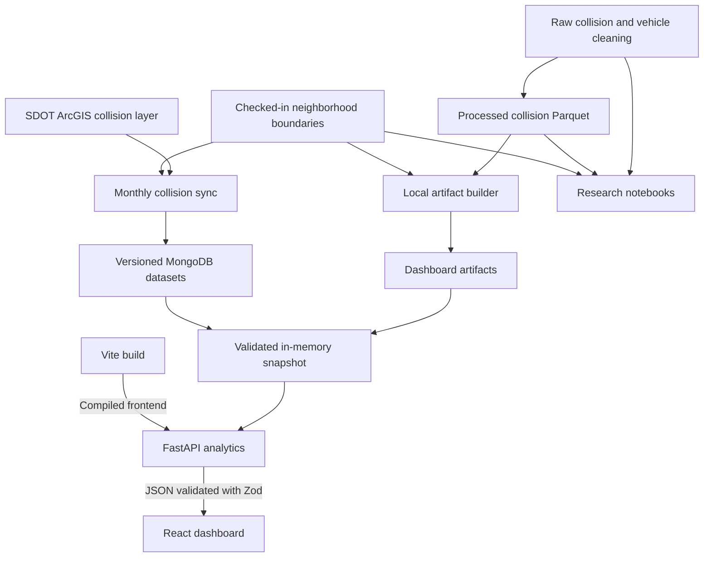

# Seattle Collision Dashboard Architecture Guide

Developer reference. Updated October 18, 2026 against repository snapshot `2a7fa31` and the setup corrections in this change.

The project is a public, read-only analytics application backed by a validated, in-memory collision dataset. React renders two workspaces, FastAPI calculates and serves their analytics, and an independent ingestion command publishes replacement datasets to MongoDB. The same API can instead load reproducible local Parquet artifacts. Historical notebooks and vehicle cleaning support research; they do not participate in a browser request.

This guide describes request handling, dataset refreshes, API contracts, and the source files used by the application and research workflows. The file reference excludes installed dependencies, credentials, caches, raw downloads, and review captures. Generated data files are described separately.

## Start here

Read these files in order to follow one feature from the screen to its data:

1. `frontend/src/main.tsx` installs the router and query cache, then mounts the app.
2. `frontend/src/App.tsx` selects the workspace inside the shared shell.
3. `frontend/src/routes/NeighborhoodExplorer.tsx` coordinates selection, queries, maps, metrics, and trends.
4. `frontend/src/lib/api.ts` translates those queries into HTTP requests.
5. `backend/app/main.py` binds HTTP routes to the current `DataStore`.
6. `backend/app/data.py` validates snapshots and implements analytical calculations.
7. `backend/app/repository.py` loads the common bundle from disk or MongoDB.
8. `backend/scripts/sync_collisions.py` and `backend/app/mongo_writer.py` explain how production data becomes available.

For visual changes, read `tokens.css`, the relevant component and its CSS Module. For analytical changes, begin with `data.py` and its metric tests. Assignment and aggregation functions live in `backend/app/dataset.py`. Both `build_artifacts.py` and production ingestion import them.

## Technology map



## Technology inventory

Versions below are manifest constraints or configured runtime versions, not a claim about every installed environment. The Python project declares ranges rather than a checked-in Python dependency lockfile. The frontend has an npm lockfile.

| Layer | Technologies | Role and evidence |
| --- | --- | --- |
| Browser application | React and React DOM `^19.2.0`; TypeScript `^5.9.3`; HTML; JavaScript; CSS Modules | `main.tsx` mounts the component tree; `.tsx` components and module styles form the UI. |
| Navigation and state | React Router DOM `^7.9.5`; TanStack React Query `^5.90.11`; React Context; URLSearchParams | Routes and URL filters live in React Router; Query caches remote results; Context distributes dataset metadata. |
| Maps and charts | Leaflet `^1.9.4`; React Leaflet `^5.0.0`; Recharts `^3.3.0`; OpenStreetMap tiles | Leaflet draws polygons and density markers; Recharts draws trends. Tile images are fetched directly by the browser. |
| Controls and fonts | Radix React Slider `^1.3.6`; Fontsource Barlow Condensed and IBM Plex Sans `^5.2.8` | The shell's year slider uses Radix. Fonts are imported into the frontend bundle. |
| Declared compatibility package | `react-is ^19.2.0` | Declared in `package.json`; no direct import in project source was found. |
| Python service | Python `>=3.11,<3.15`; FastAPI `>=0.116,<1`; Uvicorn standard `>=0.34,<1` | Docker and CI use Python 3.11. Uvicorn hosts the API and static application. |
| Response contracts | Pydantic through FastAPI; Zod `^4.6.6` | `schemas.py` defines backend response models. `contracts.ts` defines Zod schemas and inferred TypeScript types. The client validates JSON before returning it to components. |
| Tabular analytics | Pandas `>=2.2,<3`; NumPy `>=2.0,<3`; PyArrow `>=18,<23` | DataFrames, numerical summaries, histogram bins, and Parquet reads and writes. |
| Spatial analytics | GeoPandas `>=1.0,<2`; Shapely `>=2.0,<3`; SciPy `>=1.14,<2`; PyProj | Polygon assignment, point geometry, Gaussian KDE, and projected centroid distances. PyProj is imported directly but provided transitively by GeoPandas. |
| Source and transport | SDOT ArcGIS REST FeatureServer; Seattle Open Data; HTTPX `>=0.28,<1`; HTTP JSON | Ingestion downloads a complete collision snapshot using an ID list and batches. Vehicle research uses a separately downloaded CSV. |
| Durable production storage | MongoDB Atlas; PyMongo `>=4.10,<5`; dnspython `>=2.7,<3` | Versioned documents and the active-version pointer. dnspython supports SRV connection environments; application source does not import it directly. |
| Data formats | Parquet with WKB geometry; GeoJSON; CSV; JSON manifests; SHA-256 hashes | Reproducible snapshots, neighborhood polygons, research inputs, and lineage. EPSG:4326 carries longitude and latitude; EPSG:26910 supports distance and area calculations in metres. |
| Frontend build | Node 22; npm; Vite `^7.2.2`; Vite React plugin `^5.1.0`; TypeScript build mode | `npm ci --legacy-peer-deps`, `tsc -b`, and Vite build the browser assets. `frontend/vite.config.ts` configures chunking, proxies, and unit-test discovery. |
| Python packaging | pip; Hatchling | `pyproject.toml` defines installation and builds the `backend` wheel package. Root cleaning scripts and notebooks are outside that wheel target. |
| Hosting and automation | Docker; Debian Bookworm slim base images; Render; GitHub Actions; Git; Ubuntu CI runner | A multi-stage image builds the UI and runs one Python service. Actions validates the project and publishes data independently of a Render deployment. |
| Python verification | pytest `>=8.3,<9`; pytest-cov `>=6,<8`; HTTPX TestClient support; MongoDB 8.2 CI service | API, assignment, metrics, ingestion, publication, probe, and memory tests. pytest-cov is declared; default test options do not enable coverage output. |
| Browser verification | Vitest `^4.0.10`; jsdom `^27.2.0`; Testing Library React `^16.3.0`, DOM `^10.4.1`, jest-dom `^6.9.1`, user-event `^14.6.1` | Component and API-client tests in a simulated browser environment. |
| End to end verification | Playwright Test `^1.56.1`; axe-core Playwright `^4.11.0`; Chromium | Desktop and mobile browser scenarios, interaction races, URL restoration, and accessibility checks. |
| Type definitions | `@types/react ^19.2.2`; `@types/react-dom ^19.2.2`; `@types/node ^24.10.0`; `@types/leaflet ^1.9.21`; `@types/geojson ^7946.0.16` | Compile-time definitions, not runtime application services. |
| Notebook research | Jupyter notebook format; Matplotlib; Seaborn; Folium; scikit-learn; XGBoost; LightGBM; CatBoost | EDA, spatial plots, and historical regression. These packages are not fully declared by the app's `pyproject.toml`, and no notebook model is served by the app. |
| Design workflow | Figma; Impeccable; Markdown design briefs and JSON design tokens | Documents and local design tooling guide the frontend; they are not runtime data sources. |
| Development container | Dev Containers and Codespaces; Python 3.11; Node 22; VS Code Python and Pylance | The container installs dependencies, generates artifacts, builds React, and starts Uvicorn on port 8000. Port 5173 is available for optional Vite development. |

## Runtime architecture

### Browser request flow

The production container has one origin. FastAPI serves the compiled frontend from `frontend/dist` and handles `/api/...`. During development Vite serves the browser application and proxies `/api` and `/healthz` to FastAPI on port 8000. Browser map tiles come from OpenStreetMap separately.

`main.tsx` creates one `QueryClient`, with a 60-second default stale time, one retry, and window-focus refetch disabled. `App.tsx` lazy-loads the two workspace routes. `AppShell` fetches `/api/meta` every five minutes, distributes metadata through Context, and invalidates other queries after a dataset version changes.

Consider `/neighborhoods?start=2015&end=2025&neighborhood=ballard&grain=monthly`. `useDashboardParams` restores the year range, selected neighborhood, and chart grain. The explorer requests polygon geometry, all neighborhood summaries, and Ballard's context. React Query keys include the selected years and neighborhood, so changes select the appropriate cached result or start a request. Monthly and annual observations arrive together; switching grain changes chart presentation.

`api.ts` adds query parameters and passes cancellation signals to native `fetch`. FastAPI's route uses `Depends(get_store)` to obtain the current snapshot. `DataStore.neighborhood_context` reads the annual and monthly aggregates, builds metrics and comparisons, and returns Pydantic models. The client validates response JSON against the matching Zod schema before `NeighborhoodMap`, `MetricGrid`, and `TrendChart` receive it. Invalid JSON or schema mismatches raise "The server returned invalid dashboard data." A coordinate click first calls the resolver API. Generation counters prevent an older reply from replacing a newer map click or manual selection.

Neighborhood requests never send severity filters. Citywide requests include repeated `severity` parameters and use the raw collision snapshot for their calculations. React Router stores view state in the URL; local React state handles transient interaction details. There is no separate global state store.

### Snapshot loading

`DatasetBundle` is the shared boundary: a manifest, collision DataFrame, annual DataFrame, monthly DataFrame, and neighborhood GeoJSON. `ArtifactDatasetRepository` reads those from `data/dashboard`; `MongoDatasetRepository` reads one published version from MongoDB. Mongo loading projects only API-required collision columns, streams documents into columns, and uses categorical labels to reduce memory.

`DataStore` validates required fields, key uniqueness, counts, dates, complete scope coverage, and reconciliation between annual and monthly aggregates. It also constructs neighborhood geometries and derived collision flags. `DataStoreManager` serializes candidate loads with a refresh lock and swaps the current store under a separate lock only after validation succeeds. Existing readers can retain the previous store while a candidate loads.

FastAPI's lifespan performs the initial load in a worker thread. In MongoDB mode a background task checks for a changed active version every 60 seconds by default. Failed refreshes preserve the last valid snapshot. `/readyz` reads cached readiness and returns 503 when nothing valid is loaded; `/healthz` remains available and reports a degraded status. Analytics are calculated from process memory, so an ordinary data request does not query MongoDB directly.

### Data preparation and publication

There are two preparation paths. The local artifact builder reads the checked-in processed collision snapshot plus neighborhood boundaries, assigns neighborhoods, produces aggregates, and writes five dashboard artifacts. Its fixed regression baseline is 106,050 collisions: 104,579 direct assignments, 1,193 nearest assignments, and 278 unassigned records.

The production sync performs a full authoritative ArcGIS download starting January 1 2015. It verifies required field types, obtains the complete object-ID list, downloads batches of 1,000 by POST, reconciles returned IDs, and checks the layer's edit timestamp before and after download. It retries transient failures and retries the whole download when source edits occur during acquisition.

After cleaning accepted Seattle point records, ingestion uses `assign`, `aggregate_annual`, and `aggregate_monthly` from `backend/app/dataset.py`, as does the local artifact builder. It records a normalized content hash, source quality counts, and a new version identifier. `MongoDatasetWriter.publish` checks publication guards, stages version-tagged documents, reads aggregates back for validation, then changes `dataset_state.activeVersion` using a compare-and-swap condition. This pointer update publishes the dataset. No multi-collection transaction is used.

The writer rejects a backwards data date and, unless explicitly overridden, source or usable collision count decreases greater than one percent. Identical content produces a no-change result. Publication keeps the active and previous datasets and attempts to prune older ones. `rollback_dataset.py` checks the previous collision count, then swaps the active and previous versions. A second rollback reverses the first. No fallback exists after the first publication. The API validates a replacement before adopting it.

GitHub Actions runs the tests before syncing. The workflow is configured for the eighth of each month at 03:17 America/Los_Angeles and also supports manual invocation. It temporarily admits the runner IP to Atlas and uploads an ingestion manifest. This describes repository configuration; it does not establish that a deployed schedule or live database is currently healthy.

### Research path

`clean.py` coordinates the broader collision and vehicle cleaning workflow from local raw files. It preserves collision records with invalid or missing geometry in cleaned outputs and writes only accepted spatial records into the processed snapshot. It also separates orphaned vehicle records and records source lineage. This path can replace the checked-in processed data and requires a deliberate baseline review afterward.

The four notebooks analyze cleaned or processed files. The modeling notebook fits historical grid-cell regressors and compares them using training cross-validation and held-out evaluation. Its selected model does not feed a dashboard endpoint. Vehicle data has a different coverage window and does not enter the scheduled production collision sync.

## API and data contracts

All listed data endpoints use GET and return JSON. The root application also accepts HEAD for hosting probes. FastAPI exposes its generated OpenAPI interface at `/docs`.

| Endpoint | Inputs | Result |
| --- | --- | --- |
| `/healthz` and `/readyz` | None | Service status and active version; readiness uses HTTP 503 before a valid snapshot exists. |
| `/api/meta` | None | Coverage date, available and partial years, counts, metric definitions, dataset version, and publication timestamp. |
| `/api/neighborhoods/geojson` | None | Stable neighborhood polygon IDs and display names. |
| `/api/neighborhoods/summary` | `start_year`, `end_year` | Metric set for every neighborhood, used for map shading. |
| `/api/neighborhoods/resolve` | `lat`, `lng` | Neighborhood ID, assignment method, and distance where available. |
| `/api/neighborhoods/citywide-trend` | `start_year`, `end_year` | All-record Seattle metrics, annual and monthly series, comparison, and warnings. |
| `/api/neighborhoods/{id}/context` | ID and year range | Selected neighborhood metrics, annual and monthly series, comparison, and warnings. |
| `/api/citywide/summary` | Year range, optional repeated `severity` | Filtered citywide totals. |
| `/api/citywide/heatmap` | Same citywide filters | Nonempty bins from a 55 by 55 histogram, with counts and maximum weight. |
| `/api/citywide/kde` | Same citywide filters | Normalized density on a 42 by 42 grid, using at most 12,000 sampled records. |
| `/api/citywide/spatial-shift` | Same citywide filters | Pre-2020 and 2020-onward complete-year centroids and displacement in metres. |
| `/api/citywide/downtown-comparison` | Same citywide filters | Annual downtown and outer-area counts and mean severity, including partial-year flags. |

Invalid year ranges and unknown citywide severity keys become HTTP 422. Unknown neighborhood IDs become HTTP 404. Valid severity keys are `property-damage`, `injury`, `serious-injury`, `fatal`, and `unknown`. Neighborhood endpoints accept no severity parameter in their declared signatures or frontend client methods.

### Analytical rules to preserve

- The shared composite severity calculation adds injuries, three times serious injuries, and five times fatalities. Mean severity divides that burden by collision count; a zero denominator returns null.
- Neighborhood IDs are stable slugs of `S_HOOD`. Bulk assignment uses polygon containment, deterministic area and ID tie breaks, then nearest assignment within 25 metres in EPSG:26910. Remaining records are explicitly unassigned. The coordinate resolver additionally reports a boundary method for intersecting polygons.
- Citywide totals include unassigned spatial collisions. Adding the 94 neighborhood totals therefore need not equal the citywide total.
- Annual and monthly aggregates include zero observations for each scope. Monthly coverage ends at the newest incident month, not at a future December.
- Partial years remain visible but do not enter the first-versus-last three-year comparison. That comparison requires at least six complete years.
- Spatial shift uses complete years on each side of 2020. Downtown calculations use a fixed bounding box in the API; the frontend filters out partial years for its comparison chart and latest-complete-year severity value. The spatial notebook uses neighborhood polygon logic, so the two downtown definitions should not be treated as identical.
- Unknown incident times remain unknown. Night share uses only recorded incident hours as its denominator when the manifest declares `knownTimeNightShare`; older snapshots return null for that measure.
- Inspector metrics omit Night and Weekend and show burden and mean severity separately. The default metric grid can still display those measures.
- Backend Pydantic models and frontend Zod schemas are manually paired. TypeScript types are inferred from Zod. A response-field change requires matching schema updates and contract tests.

### MongoDB collections

| Collection | Purpose |
| --- | --- |
| `collisions` | Accepted spatial collision documents tagged with `datasetVersion`; uniqueness is enforced for version and `COLDETKEY`. |
| `neighborhood_annual` | One aggregate per version, scope, and year. Includes the `citywide` scope. |
| `context_monthly` | One aggregate per version, scope, and month. |
| `neighborhoods` | The full neighborhood FeatureCollection for a version. |
| `ingestion_runs` | Source metadata, manifests, hashes, statuses, failure details, and publication records. |
| `dataset_state` | The `_id: active` document with current and previous version pointers and publication metadata. |

## File reference

Each entry describes a file's responsibility and its connections. Paths are relative to the repository root. Generated artifacts and build outputs appear in the generated-files section.

### Root documentation and configuration

**`README.md`** — Project entry point covering research context, datasets, local setup, API usage, ingestion, validation, Docker, and deployment. Start here for operational commands; verify behavior against code when older narrative and implementation differ.

**`PRODUCT.md`** — Product contract defining users, the two workspaces, analytical invariants, coverage expectations, and accessibility requirements. It explains why neighborhood severity filtering remains independent from citywide filtering.

**`DESIGN.md`** — Human-readable visual system, including palette, typography, geometry, component styling, and dashboard presentation rules. Connects design intent to frontend tokens and component styles.

**`FIGMA.md`** — Figma handoff with the design file, approved foundation and component identifiers, and the limits of the completed page handoff. It is a design reference, not app configuration.

**`pyproject.toml`** — Python package metadata, supported Python versions, backend dependencies, test extras, Hatchling wheel target, and pytest discovery. Only `backend` is packaged into the wheel.

**`Dockerfile`** — Builds frontend assets in Node 22, installs the backend into Python 3.11, copies the built UI, and runs Uvicorn as a non-root user. Uses `/readyz` for health checks and includes no production dataset.

**`render.yaml`** — Render service blueprint using the Dockerfile, Oregon region, `/readyz`, MongoDB mode, and refresh/source settings. The database URI is a deployment secret.

**`.env.example`** — Placeholder settings for backend selection, MongoDB URI and database, refresh interval, and ArcGIS URL. `Settings.from_env` reads process environment; this file is not automatically loaded.

**`.gitignore`** — Excludes raw/cleaned data, dashboard artifacts, environments, credentials, node modules, builds, caches, and review captures. Explicitly retains `.env.example`.

**`.dockerignore`** — Removes Git internals, local environments, notebooks, generated dashboard data, frontend outputs, and design tooling from build context. It excludes most Markdown but retains `README.md`; the Dockerfile controls what actually enters the image.

**`.devcontainer/devcontainer.json`**. Python 3.11 container with Node 22 and artifact mode. Named volumes keep the Python environment and frontend packages separate from host dependencies. Creation installs dependencies, builds dashboard artifacts, and compiles React. Container startup launches Uvicorn on port 8000 and logs to `/tmp/dashboard-api.log`. Reattaching does not start another server. Port 5173 is forwarded for optional Vite development.

**`.github/workflows/monthly-collision-sync.yml`** — Scheduled and manual CI-to-publication workflow. Starts MongoDB 8.2 for integration tests, builds local artifacts, runs Python and frontend checks, opens temporary Atlas access, executes sync, and retains its manifest.

**`.impeccable/config.json`** — Local Impeccable workflow configuration with `buildPath` set to `code`. It is not consumed by the app runtime.

**`.impeccable/design.json`** — Machine-readable design-system metadata and tokens used by the design workflow. The browser's executable theme values live in `frontend/src/styles/tokens.css`.

**`.impeccable/surfaces/frontend.md`** — Detailed frontend surface brief describing hierarchy, map/inspector composition, selection behavior, and responsive presentation. Use it alongside `PRODUCT.md` when changing interaction design.

### Cleaning and feature preparation

**`clean.py`** — CLI and coordinator for collision cleaning, vehicle cleaning, processed features, and manifest creation. Uses temporary files followed by replacement for individual outputs; writes cleaned and processed Parquet plus optional GeoJSON and vehicle CSV. It is outside the deployed backend package.

**`cleaning_base.py`** — Shared `BaseCleaner` with column validation, datetime parsing, year filtering, freshness limits, source change checks, and SHA-256 lineage. Both concrete cleaners inherit it.

**`collision_clean.py`** — `CollisionCleaner` reads raw collision GeoJSON, normalizes categories, preserves unknown times, labels geometry quality, and validates counts and keys. `process` keeps accepted point geometries and adds severity, pedestrian/cyclist totals, coordinates, and 150-bin latitude/longitude features for downstream research and artifacts.

**`vehicle_clean.py`** — `VehicleCleaner` reads selected CSV columns, maps vehicle descriptions to stable categories, joins against cleaned collision keys, and separates orphaned rows. Returns data and quality statistics to `clean.py`; production collision sync does not call it.

### Checked in data

**`data/processed/Collision_Processed.parquet`** — Preserved spatial snapshot with 106,050 rows and 43 columns, including WKB point geometry, dates, counts, temporal features, and grid bins. Feeds `build_artifacts.py` and the modeling notebook; coverage ends August 31 2026.

**`data/processed/Neighborhood_Map_Atlas_Neighborhoods.geojson`** — The 94 neighborhood polygons with `S_HOOD` and `L_HOOD` labels. Both preparation paths derive stable IDs and assignments from this boundary source.

**`data/processed/cleaning_manifest.json`** — Cleaning run lineage, source hashes and dates, exclusion counts, quality warnings, output metadata, and processed schema. Records 109,040 cleaned collisions, 2,990 missing geometries, and the 106,050 spatial records; vehicle coverage ends January 23 2026.

### Backend application

**`backend/__init__.py`** — Marks the installable backend package and describes its purpose. No service startup occurs here.

**`backend/app/__init__.py`** — Marks the FastAPI application subpackage. Actual app construction is in `main.py`.

**`backend/app/config.py`** — Immutable `Settings` parsed from process environment. Validates artifact/MongoDB mode, requires a Mongo URI in Mongo mode, enforces a refresh interval of at least ten seconds, and provides the ArcGIS default URL.

**`backend/app/main.py`** — HTTP entry point, lifespan loader and polling task, dependency injection, route definitions, probe handling, response models, and compiled SPA delivery. Delegates analytical work to `DataStore`; protects unknown `/api` paths from the SPA fallback.

**`backend/app/data.py`** — Main analytical layer and snapshot manager. Implements bundle validation, metadata, metrics, zero-filled series responses, complete-year comparisons, coordinate resolution, histogram/KDE density, centroid shift, and downtown bounding-box comparison. `DataStoreManager` handles concurrent loads and safe replacement.

**`backend/app/dataset.py`**. Shared neighborhood loading, assignment, severity calculations, annual and monthly aggregation, source hashing, and partial-year rules. Both local artifact generation and live ingestion use these functions.

**`backend/app/repository.py`** — Defines `DatasetBundle` and disk/Mongo repository adapters. Restricts runtime collision columns, compacts repeated labels, reads one active Mongo version, and returns the same in-memory shape for both storage modes.

**`backend/app/schemas.py`** — Pydantic response contracts for metadata, health, metrics, annual/monthly series, resolution, density, spatial shift, downtown comparison, and errors. Uses `extra="forbid"`; paired frontend types live in `contracts.ts`.

**`backend/app/mongo_writer.py`** — Operational writer with index creation, Python-to-Mongo value conversion, batched staging, aggregate read-back validation, publication guards, compare-and-swap pointer updates, cleanup, and rollback. Invoked by scripts, not by public data routes.

### Backend operational commands

**`backend/scripts/__init__.py`** — Marks the operational-command package so scripts can run through `python -m backend.scripts...`.

**`backend/scripts/build_artifacts.py`**. Local artifact builder. Loads preserved data, calls the shared preparation functions in `dataset.py`, and writes dashboard files and a manifest. `load_sources` enforces the fixed row baseline even when assignment-baseline drift is allowed.

**`backend/scripts/sync_collisions.py`** — Production ingestion CLI, `ArcGISClient`, live-source cleaning, content hashing, bundle construction, manifest reporting, and orchestration of the Mongo writer. Reuses assignment and aggregate functions but validates changing live counts separately from the preserved local baseline.

**`backend/scripts/rollback_dataset.py`** — Small CLI that loads settings, creates the operational writer, invokes rollback, prints the result, and closes the client. Requires database write credentials.

### Backend tests

**`backend/tests/conftest.py`** — Session-scoped `DataStore` fixture loaded directly from `data/dashboard`. Test setup therefore requires artifact generation and exercises the direct source-validation path.

**`backend/tests/test_api.py`** — HTTP contract tests for metadata, polygons, neighborhood context, citywide trend, citywide analytics, invalid IDs, and year/filter validation.

**`backend/tests/test_arcgis_ingestion.py`** — Mock HTTP tests for ID batching, downloads beyond transfer limits, source-change restarts, field-schema drift, and transient request retries.

**`backend/tests/test_artifacts.py`** — Regression tests for assignment counts, source hashes, monthly zero filling and reconciliation, partial-year rollover, coordinate resolution, and deterministic shared-boundary behavior.

**`backend/tests/test_metrics.py`** — Tests severity arithmetic, nullable shares, known-time night denominators, legacy snapshot behavior, complete-year comparisons, neighborhood filter isolation, and spatial-shift exclusions.

**`backend/tests/test_mongo_repository.py`** — Optional Mongo integration tests for staging, loading, rollback, failed publication, unchanged content, and row-decrease guards. Activated through `MONGODB_TEST_URI`; CI supplies the database.

**`backend/tests/test_probes.py`** — Tests root HEAD probes and ensures health/readiness probes remain responsive without trying to load an unavailable dataset.

**`backend/tests/test_publication_guards.py`** — Focused test that a usable spatial-row decrease still requires override when the upstream source-row count stays steady. Uses a lightweight fake database boundary.

**`backend/tests/test_snapshot_memory.py`** — Tests streamed decoding, a collision-frame memory budget below 20 MiB, serialized concurrent refresh, previous-snapshot retention, and metadata reads without database refresh.

**`backend/tests/test_time_quality.py`** — Checks date-only and wholly unknown incident times across the root cleaner and live-source cleaner. Confirms those records do not become false midnight observations.

### Frontend build and entry points

**`frontend/package.json`** — Direct browser and development dependencies plus dev/build/test/preview commands. `build` runs TypeScript build mode before Vite; `test` runs Vitest and `test:e2e` runs Playwright.

**`frontend/package-lock.json`** — npm's resolved dependency graph, versions, integrity values, and package metadata for repeatable `npm ci`. It is generated dependency data, not application logic.

**`frontend/index.html`** — SPA document with metadata, accessible skip link, root mount element, and `main.tsx` module entry. FastAPI serves its compiled counterpart after a build.

**`frontend/vite.config.ts`**. The sole checked-in Vite configuration. Sets React transformation, API proxies, separate maps, charts, and query chunks, jsdom setup, and unit-test discovery that excludes browser tests.

**`frontend/tsconfig.json`** — TypeScript project-reference root connecting application/test checking and Node-side configuration checking.

**`frontend/tsconfig.app.json`** — Strict browser/test type-checking settings, ES2022 and DOM libraries, React JSX, bundler resolution, no JavaScript input, and no emitted app code. Includes `src` and `tests`.

**`frontend/tsconfig.node.json`** — Composite, no-emit TypeScript configuration for Vite and Playwright config files, using ES modules and bundler resolution.

**`frontend/playwright.config.ts`** — End-to-end runner configuration, API/static server startup on port 4173, failure traces, and Chromium desktop/mobile profiles. Uses the repository virtual environment locally and system Python in CI.

**`frontend/src/main.tsx`** — Browser bootstrap importing fonts, Leaflet CSS, tokens, and global styles. Mounts StrictMode, QueryClientProvider, BrowserRouter, and `App`.

**`frontend/src/App.tsx`** — Lazy workspace routes within `AppShell`; redirects the root and unknown paths to `/neighborhoods`. Uses Suspense with the shared loading state.

**`frontend/src/vite-env.d.ts`** — Vite client type reference for frontend build-time globals and asset typing. Compile-time support only.

### Frontend contracts and shared logic

**`frontend/src/lib/api.ts`**. HTTP client over native `fetch`. Builds query parameters, forwards AbortSignals, extracts API errors, and validates response JSON with Zod. Neighborhood requests omit severity filters.

**`frontend/src/lib/contracts.ts`**. Zod schemas for metadata, metrics, series, GeoJSON, and analytical responses. `z.infer` derives TypeScript types from these schemas. `api.ts` uses them for runtime validation. Keep them aligned with backend Pydantic models.

**`frontend/src/lib/dataset.tsx`** — React Context provider and `useDatasetMeta` hook with temporary loading defaults. Supplies server-derived date coverage and year bounds to shell, controls, charts, and URL parsing.

**`frontend/src/lib/useUrlState.ts`** — `useDashboardParams` restores and updates years, neighborhood, metric, grain, city layer, and severities through search parameters. Clamps years, normalizes invalid severity values, and preserves browser navigation history for committed changes.

**`frontend/src/lib/format.ts`** — Shared locale-aware integer, decimal, ratio-to-percent, and signed-change formatters. Displays null/NaN measurements as an em dash.

**`frontend/src/lib/severity.ts`** — Single frontend list of citywide severity keys and labels, including Unknown. Used by both checkbox rendering and URL validation.

### Frontend components

**`frontend/src/components/AppShell.tsx`** — Shared desktop/mobile navigation, metadata status, Radix year-range slider, and route outlet. Polls metadata every five minutes and invalidates data queries when the dataset version changes; slider drafts commit to the URL once per completed interaction.

**`frontend/src/components/AppShell.module.css`** — Shell rail, command header, year slider, partial-year styling, and responsive navigation layout. Defines visual structure for `AppShell`.

**`frontend/src/components/NeighborhoodMap.tsx`** — Leaflet polygon map with metric-dependent shading, selection styling, click-to-resolve, fit-to-selection, and reduced-motion awareness. Uses external OpenStreetMap tiles and server-provided GeoJSON.

**`frontend/src/components/NeighborhoodMap.module.css`** — Neighborhood map sizing, tile treatment, legend, resolving hint, and selected-polygon pulse styling.

**`frontend/src/components/NeighborhoodPicker.tsx`** — Searchable ARIA combobox with sorted neighborhood options, keyboard navigation, active option, selection, and clear behavior. Provides an accessible alternative to clicking the map.

**`frontend/src/components/NeighborhoodPicker.module.css`** — Search field, icon, clear action, popup listbox, selected/active option, and no-results presentation.

**`frontend/src/components/MetricGrid.tsx`** — Formats a metric set into a definition-list grid with neutral, caution, fatality, and supporting tones. The inspector variant removes burden/mean duplicates and Night/Weekend shares.

**`frontend/src/components/MetricGrid.module.css`** — Grid density, compact layouts, numeric typography, cell borders, and semantic metric colors.

**`frontend/src/components/TrendChart.tsx`** — Recharts collision area and severity line for annual or monthly observations. Builds month ticks and tooltips, marks partial coverage from metadata, and shows a selection pulse.

**`frontend/src/components/TrendChart.module.css`** — Trend plot sizing, series legend, partial-year marker, pulse animation, and mobile marker placement.

**`frontend/src/components/CitywideMap.tsx`** — Leaflet density surface drawing weighted histogram circles or KDE circles, centroid displacement, and the downtown bounding rectangle. Receives already calculated responses rather than computing KDE in the browser.

**`frontend/src/components/CitywideMap.module.css`** — Citywide map frame, full-size map area, and tile appearance.

**`frontend/src/components/Icons.tsx`** — Local inline SVG icons for navigation, search, alerts, checks, chevrons, and branding. Avoids a separate runtime icon library.

**`frontend/src/components/States.tsx`** — Shared loading, retryable error, and empty-result components with status/alert semantics. Used by both workspaces and lazy-route loading.

**`frontend/src/components/States.module.css`** — Shared state spacing, spinner animation, retry styling, and error emphasis.

### Frontend workspaces and theme

**`frontend/src/routes/NeighborhoodExplorer.tsx`** — Main planner workspace. Coordinates polygon and summary queries, neighborhood/citywide inspector context, annual/monthly trends, URL selection, accessible announcements, and protection against out-of-order resolver replies.

**`frontend/src/routes/NeighborhoodExplorer.module.css`** — Explorer control row, map/inspector split, burden display, warnings, trend section, grain controls, selection pulse, and mobile stacking.

**`frontend/src/routes/CitywideAnalysis.tsx`** — Severity-filtered analytical workspace. Queries summary, the active density layer, centroid shift, and downtown comparison; renders map layers, complete-year comparisons, and the latest complete-year downtown severity.

**`frontend/src/routes/CitywideAnalysis.module.css`** — Severity controls, density tabs, map and analytical rail, comparison chart, warning treatment, and responsive citywide layout.

**`frontend/src/styles/tokens.css`** — Runtime CSS custom properties for the civic palette and display/body fonts. Shared by global styling and component CSS Modules.

**`frontend/src/styles/global.css`** — Base document and input styles, scrollbar styling, visible keyboard focus, skip link, screen-reader utility, and reduced-motion overrides.

### Frontend tests

**`frontend/tests/setup.ts`** — Installs jest-dom matchers, cleans up rendered components, and supplies ResizeObserver and matchMedia mocks for jsdom.

**`frontend/tests/api.test.ts`** — Verifies the client omits severity on neighborhood routes and emits repeated severity parameters for citywide routes.

**`frontend/tests/contracts.test.ts`** and **`frontend/tests/e2e/contracts.spec.ts`**. Check response schemas and browser error handling for invalid API responses.

**`frontend/tests/AppShell.test.tsx`** — Checks that a changed metadata dataset version invalidates cached dashboard queries.

**`frontend/tests/MetricGrid.test.tsx`** — Verifies inspector metric omissions and the default grid's preservation of situational shares.

**`frontend/tests/NeighborhoodPicker.test.tsx`** — Exercises keyboard-only search/selection and clearing the active neighborhood.

**`frontend/tests/TrendChart.test.tsx`** — Checks partial-year labels use the active dataset year and received-through date rather than a hard-coded year.

**`frontend/tests/useUrlState.test.tsx`** — Tests URL restoration and updates, monthly grain, metadata-derived year bounds, and invalid/unknown severity handling.

**`frontend/tests/e2e/dashboard.spec.ts`** — Full browser scenarios for URL-linked selection, citywide fallback, year changes, severity isolation and normalization, complete-year comparisons, resolver races, slider history, accessibility, and review captures. Runs in both configured viewport profiles.

### Research notebooks

**`notebooks/all_collisions_eda.ipynb`** — 24-cell collision EDA notebook reading cleaned Parquet. Uses Pandas, GeoPandas, Matplotlib, and Seaborn for temporal and categorical distributions; outputs are research figures rather than dashboard assets.

**`notebooks/vehicle_eda.ipynb`** — Four-cell vehicle notebook reading cleaned vehicle CSV. Uses Pandas, NumPy, Matplotlib, Seaborn, and a GeoPandas import to examine vehicle categories and yearly involvement.

**`notebooks/geo.ipynb`** — Ten-cell spatial notebook reading cleaned collision GeoJSON and neighborhood polygons. Uses Folium HeatMap, SciPy KDE and Mann-Whitney tests, and standard plotting libraries; exports processed collision GeoJSON. Its polygon-based downtown definition differs from the API bounding box.

**`notebooks/model.ipynb`** — 33-cell historical grid-cell severity regression notebook reading processed Parquet. Uses scikit-learn pipelines, imputation, target stabilization, repeated cross-validation, and tuning for decision trees, random forests, XGBoost, LightGBM, and CatBoost. No application model artifact or inference route is produced.

## Generated files and local operations

These paths are operationally important even though they are excluded from the tracked-file inventory:

| Path | Created by | Used by |
| --- | --- | --- |
| `data/dashboard/collisions_assigned.parquet` | Artifact builder | Local repository and collision-based citywide calculations. |
| `data/dashboard/neighborhood_annual.parquet` | Artifact builder | Neighborhood metrics and annual trends, plus citywide aggregate scope. |
| `data/dashboard/context_monthly.parquet` | Artifact builder | Monthly trends for every neighborhood and the citywide scope. |
| `data/dashboard/neighborhoods.geojson` | Artifact builder | Local runtime geometry and neighborhood IDs. |
| `data/dashboard/manifest.json` | Artifact builder | Dataset version, dates, source hashes, and assignment counts. |
| `data/cleaned/` | Root cleaning coordinator | EDA notebooks and cleaning audit outputs, including excluded geometries and orphan vehicles. |
| `data/processed/Collision_Processed.geojson` | Cleaning or spatial notebook | Optional spatial export; not the app's canonical input. |
| `frontend/dist/` | Frontend build | FastAPI's SPA and asset delivery. |
| `.impeccable/review/` | Browser tests and design review | Local review images; not shipped application content. |

### Local workflow

The following commands run from the repository root unless shown otherwise. The examples assume Python 3.11, Node 22, an existing `.venv`, and installed frontend packages. The full initial installation procedure is in `README.md`.

```bash
export DASHBOARD_DATA_BACKEND=artifacts
.venv/bin/python -m backend.scripts.build_artifacts
cd frontend
npm run build
cd ..
```

After the frontend build, return to the repository root, then start `.venv/bin/uvicorn backend.app.main:app --reload`. FastAPI serves the application at `http://127.0.0.1:8000` if `frontend/dist` exists. For live frontend development, run `npm run dev` from `frontend` while the API remains running.

Relevant checks are `.venv/bin/python -m pytest backend/tests -q` from the root and `npm test`, `npm run build`, and `npm run test:e2e` from `frontend`. Browser tests need built assets, generated dashboard artifacts, Chromium, and the review directory. Mongo integration tests additionally need `MONGODB_TEST_URI`.

Production data operations are `python -m backend.scripts.sync_collisions --dry-run`, the same command without `--dry-run` to publish, and `python -m backend.scripts.rollback_dataset` to restore the previous version. They require the operational environment and database credentials described in `README.md`; the runtime dashboard should use a separate read-only database user.

## Configuration notes and change boundaries

**Vite uses the TypeScript configuration.** `frontend/vite.config.ts` is the sole checked-in Vite configuration. `tsconfig.node.json` uses `noEmit`, and `.gitignore` excludes generated JavaScript, declarations, and incremental build metadata.

**Source hash validation has two paths.** Direct construction of `DataStore` checks source hashes by default, as does the test fixture. `DataStoreManager` loads a bundle without source-hash checks and validates the generated snapshot. After changing processed inputs, run `.venv/bin/python -m backend.scripts.build_artifacts` and restart the API. Readiness does not prove source freshness.

**The development container uses local artifacts.** Its creation hook builds artifacts and React. Its startup hook runs Uvicorn. Restart the API after rebuilding artifacts, or restart the container. Vite development is optional and runs separately on port 5173.

**Notebook environments need additional dependencies.** Matplotlib, Seaborn, Folium, scikit-learn, and the boosting libraries are imported by research notebooks but are not part of the backend dependency list. Installing the backend package alone does not reproduce the research environment.

**One snapshot is held per worker process.** Locks protect refreshes within a process; multiple Uvicorn workers would each load and refresh their own snapshot. The checked-in launch command uses the default single-worker invocation. The memory test measures the collision frame, not total process memory or the combined old/new snapshot footprint.

**Changes cross explicit boundaries.** A new metric usually touches shared aggregation, bundle validation, Pydantic and Zod schemas, display formatting, and metric tests. Update contract tests when response fields change. A new filter touches URL parsing, query keys, client parameter construction, server validation, and isolation tests. A neighborhood-boundary change affects IDs, assignment baselines, geometry, and both preparation paths. A layout change generally stays within the relevant component, CSS Module, tokens, and browser checks.

**Dataset dates describe the preserved snapshot.** The checked-in collision data ends August 31 2026 and the vehicle source ends January 23 2026. A live deployment may serve a newer published version; `/api/meta` is the browser's source of truth for that version's coverage.

## Evidence used

The original guide used commit `b3c3386` and inspected the processed dataset and 94 neighborhood polygons. The October 18 update checked setup, repository loading, publication, frontend configuration, and response contracts at `2a7fa31`. It replaces missing diagram assets with the Mermaid graph above. Deployment health and live dataset coverage require separate checks against Render, Atlas, and ArcGIS.
